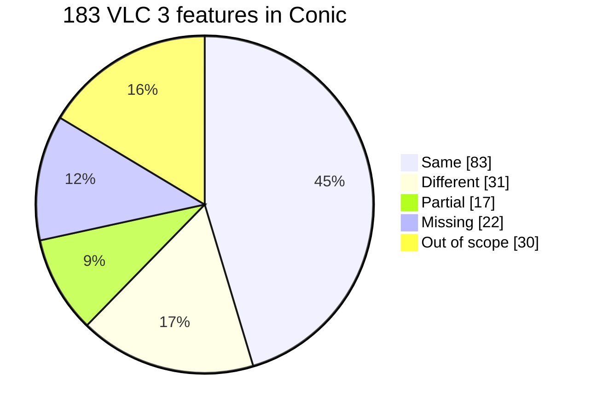

# Conic

Conic is a modern copy of VLC 3's desktop player. Media plays through VLC
3.0.24's own engine, and a new interface, written in C# with
[Avalonia](https://avaloniaui.net/), replaces VLC's Qt one. It runs on Windows,
macOS and Linux.

> [!NOTE]
> Conic is a one-off experiment. It is not made or endorsed by VideoLAN, it
> will not be maintained, and issues and pull requests may go unanswered. To
> watch videos, use [VLC](https://www.videolan.org/vlc/).


## What it is

Conic keeps VLC 3 as it is (the same engine, codecs, filters and options) and
rebuilds the desktop app around it:

- **Home**, with recent media, favorites and saved positions, in a grid or a
  list, and a floating mini player while something plays.
- **The player**, with a docked control bar and side panels for the queue,
  audio, video, subtitles, chapters and media information.
- **Picture in picture**, an always-on-top compact player.
- **Settings**, in twelve pages. Each row takes effect, and a tag says when:
  **Live**, at the **Next open**, or after a **Restart**.
- **Messages**, VLC's log, live, as in VLC.
- **Dark and Light themes**, accent colors and a compact density.

| | |
| --- | --- |
|  |  |
|  |  |

[VLC 3 and Conic, side by side](docs/contest/COMPARISON.md) compares the same
workflows in both apps.

### Parity with VLC 3

Conic reaches **80% parity** with VLC 3's desktop player. Of 183 VLC 3
features, 30 were left out on purpose. Of the 153 others, 83 work the same, 31
work differently, 17 work in part and 22 are missing. Parity counts Same and
Different as 1, Partial as 1/2 and Missing as 0.



| Area | Parity | Same | Different | Partial | Missing | Out of scope |
| --- | --- | --: | --: | --: | --: | --: |
| Media menu | █████████░ 85% | 3 | 4 | 3 | 0 | 4 |
| Playback menu | █████████░ 92% | 10 | 1 | 0 | 1 | 2 |
| Audio menu | ████████░░ 83% | 3 | 2 | 0 | 1 | 0 |
| Video menu | ███████░░░ 70% | 4 | 3 | 0 | 3 | 0 |
| Subtitle menu | ██████████ 100% | 2 | 0 | 0 | 0 | 0 |
| Tools menu | ███████░░░ 69% | 3 | 7 | 5 | 3 | 4 |
| View menu | █████████░ 88% | 3 | 4 | 0 | 1 | 1 |
| Help menu | ██████████ 100% | 1 | 1 | 0 | 0 | 1 |
| Preferences | █████████░ 87% | 33 | 2 | 5 | 3 | 6 |
| Playlist and queue | █████████░ 85% | 7 | 3 | 2 | 1 | 0 |
| Library | █████░░░░░ 50% | 0 | 1 | 0 | 1 | 3 |
| Hotkeys and mouse | ████████░░ 75% | 5 | 1 | 0 | 2 | 0 |
| Command line and OS integration | ██████░░░░ 64% | 5 | 1 | 2 | 3 | 2 |
| Network and streaming | ██████░░░░ 63% | 4 | 1 | 0 | 3 | 7 |
| **Total** | **████████░░ 80%** | **83** | **31** | **17** | **22** | **30** |

#### What's missing, and why

| Why | Missing features |
| --- | --- |
| Not in the redesign | Bookmarks, the Video Track menu, library folders (My Videos…), status bar, system title bar |
| Broken in VLC 3.0.24 | Post-processing (no visible effect), stereo widener (refuses the usual output chains) |
| Need VLC's own video window | Set as wallpaper, 360° video navigation |
| Need TV input or extra hardware | Program guide (EPG), Teletext, AtmoLight |
| Refused on purpose | Credentials in URLs (they would be kept in the history) |
| Not done (this is an experiment) | Visualizations, global hotkeys, the OS media controls, taskbar buttons, VLC options on the command line, mouse gestures, nested playlists |

The 17 partial features mostly have fewer options than VLC (some video
filters, playlist formats, queue sort) or work on Windows only (screensaver,
HTTP proxy). Disc menus, streaming and conversion, capture devices, skins and
extensions were left out from the start.
[Feature parity with VLC 3](docs/FEATURE_PARITY.md) compares the two, feature
by feature.

## How it's built

- **Avalonia 12** draws the whole interface, from one C# codebase for Windows,
  macOS and Linux.
- **VLC 3.0.24, through libvlccore.** Conic doesn't go through the public
  LibVLC API. It loads libvlccore, VLC's core library, and starts each core
  with the same internal entry points LibVLC is built on
  (`libvlc_InternalCreate`, `libvlc_InternalInit`, `libvlc_InternalAddIntf`).
  That lets it do what VLC's own interfaces do from inside the core: pass each
  core its options, change variables on the playing input and audio output,
  and load its own plugins.
- **[VLCLR](https://github.com/mfkl/vlclr/tree/3.x)**, a C# framework for
  writing VLC 3 plugins, compiled with Native AOT. Conic's control interface
  and its video output are VLCLR plugins, so there is no native C shim.
- **Video inside Avalonia's composition.** The video output plugin hands
  decoded frames to Avalonia as GPU textures: a D3D11 shared texture on
  Windows, an IOSurface on macOS, a DMA-BUF converted by VA-API on Linux. The controls draw over the video in the same
  window, with hardware decoding on and no copy through the CPU on the
  validated paths.

Conic was built with AI assistance (Claude Code) for implementation and
testing.

## Design credit

The interface, its icons and its Settings pages follow the
[VLC Redesign](https://www.figma.com/community/file/1691465999134370980/vlc-redesign)
Figma Community file by [Juxtopposed](https://www.youtube.com/@juxtopposed),
presented in the video
[I Redesigned VLC After 25 Years](https://www.youtube.com/watch?v=ERFeOgqk324).
The design is Juxtopposed's work, shared on Figma Community, and Conic uses it
with credit. Where the app differs from the design, the difference is ours.

## Install

Preview builds are portable archives on the
[Releases](https://github.com/mfkl/conic/releases) page. Each one bundles VLC
3.0.24, so no separate VLC install is needed. The builds are not signed, so
each OS warns on the first launch.

- **Windows x64:** unzip `Conic-<version>-win-x64.zip` anywhere and run
  `Conic.exe`. If SmartScreen stops it, choose **More info**, then
  **Run anyway**.
- **macOS:** unzip `Conic-<version>-osx-<arch>.zip` (`arm64` for Apple
  silicon, `x64` for Intel) and move `Conic.app` to Applications. On the
  first launch macOS refuses to open it; open **System Settings > Privacy &
  Security** and choose **Open Anyway**.
- **Linux x64:** not published yet. `eng/package-linux.ps1` builds a tarball
  that uses the distribution's VLC 3 packages (`libvlccore9`, `libvlc5`,
  `vlc-plugin-base`) and a VA-API driver.

To remove the app, delete its folder (Windows) or the app (macOS). Settings
and history stay in your user profile.

### Reporting a problem

As in VLC, **Messages** shows the engine's log live: press **Ctrl+Shift+M**
(**Cmd+Shift+M** on macOS), or open it from the right-click menu (**More
Settings > Messages**), the macOS **Window** menu or **Settings > Advanced**.
Set **Verbosity** to **Debug**, reproduce the problem (opening the media again
if it fails to open), then **Save…** the log and attach it to your report.
Remember that Conic is not maintained.

## Platform status

| Platform | Playback | Checked on |
| --- | --- | --- |
| Windows x64 | D3D11 hardware decoding, GPU presentation, CPU fallback | Intel Iris Xe; 14-case package qualification |
| macOS arm64/x64 | VideoToolbox decoding, IOSurface presentation | M1 Pro; CI's arm64 and x64 runners |
| Linux x64 | Software decoding (distribution VLC 3.0.20 has no VA-API decoder), VA-API conversion, DMA-BUF presentation, CPU fallback; Wayland and X11 | Intel Iris Xe (iHD), GNOME 46; engine in CI |

Status, October 2026: the parity features (80%) are checked on Windows by
the smoke tests below, with hardware and software decoding, and the network
protocols by `--protocols-smoke` (UDP, RTP, RTMP, FTP, SMB). Their macOS run
is pending; on Linux they run headless with `eng/test-linux.ps1 -Window
-Headless`.

| Checked on Windows | Smoke |
| --- | --- |
| Next Frame, Jump to Time, A-B loop, snapshots, chapters, programs, Hide UI | `--parity-smoke` |
| Live video effects, overlays, crop, deinterlacing, stereo mode, live subtitles | `--parity-smoke` |
| UDP, RTP, RTMP, FTP, SMB from local servers | `--protocols-smoke` |
| One instance: a second start hands its file over | two processes, by hand |

Windows checks cover H.264 (NV12) and HEVC Main 10 (P010) hardware decoding,
software decoding uploaded to the GPU, and the CPU bitmap fallback. Subtitles
are rendered by VLC and drawn above the video, so they also show with hardware
decoding. Multi-GPU switching, sleep and resume, and styled ASS or image
subtitles are not qualified.

## Building from source

### Repository layout

VLCLR is a git submodule at `external/vlclr`, tracking the `3.x` branch of
[mfkl/vlclr](https://github.com/mfkl/vlclr/tree/3.x). That branch also holds
the VLC 3 import library and the native layout probe. The pinned commit is
recorded in [`eng/versions.json`](eng/versions.json). Clone with submodules:

```
git clone --recursive https://github.com/mfkl/conic.git
# or, in an existing clone:
git submodule update --init
```

GitHub's "Download ZIP" leaves the submodule out; clone instead.

The architecture boundary is recorded in
[`docs/rfc/0001-port-boundaries.md`](docs/rfc/0001-port-boundaries.md), and the
pinned native and framework inputs in [`eng/versions.json`](eng/versions.json).

### Build and run

Windows x64 development requires PowerShell 7, .NET 10 (CI pins SDK
10.0.102), the Visual Studio C++ build tools and Windows SDK for Native AOT, and
the VLC 3 runtime pinned in `eng/versions.json`. `eng/get-vlc.ps1` downloads it
to `artifacts/dependencies/vlc-3.0.24`, where development runs find it.

```powershell
./eng/get-vlc.ps1
dotnet publish src/Conic.Vout -c Release -r win-x64

Copy-Item `
  src/Conic.Vout/bin/Release/net10.0/win-x64/native/libvlc_avalonia_plugin.dll `
  artifacts/dependencies/vlc-3.0.24/plugins/video_output/ `
  -Force

artifacts/dependencies/vlc-3.0.24/vlc-cache-gen.exe `
  artifacts/dependencies/vlc-3.0.24/plugins

dotnet run --project src/Conic
```

Smoke tests play the clip named by `CONIC_TEST_MEDIA`. The repository has
no media; `eng/make-settings-fixtures.ps1` generates synthetic clips with
ffmpeg into `artifacts/settings-fixtures`:

```powershell
./eng/make-settings-fixtures.ps1
$env:CONIC_TEST_MEDIA = "$PWD/artifacts/settings-fixtures/gop.mp4"
dotnet run --project src/Conic -- `
  --smoke --expect-path=hardware-opaque-gpu
dotnet run --project src/Conic -- `
  --smoke --expect-path=software-bgra-gpu-upload
dotnet run --project src/Conic -- `
  --smoke --expect-path=cpu-bitmap
dotnet run --project src/Conic -- --ui-smoke
dotnet run --project src/Conic -- --engine-smoke --cycles=25
```

Override local paths with `VLC_DIRECTORY` and `CONIC_TEST_MEDIA`.
Installed applications find VLC in an adjacent `vlc` directory.
`VLC_DIRECTORY` takes precedence and must point to the directory containing the
native VLC libraries. The default plugin location is `plugins/video_output`
beneath that directory.

On macOS, `eng/get-vlc.ps1` downloads the pinned VLC 3.0.24 DMG (an installed
`/Applications/VLC.app` also works), `eng/test-macos.ps1 -Media <clip> [-Window]`
runs the engine, IOSurface and window smokes, and `eng/package-macos.ps1`
builds an ad hoc signed `Conic.app`. See
[the cross-platform status](docs/CROSS_PLATFORM.md).

On Linux x64, install the distribution's VLC 3 packages (`libvlccore9`,
`libvlc5`, `vlc-plugin-base`) and a VA-API driver (`intel-media-va-driver` or
`mesa-va-drivers`). `eng/test-linux.ps1 -Media <clip> [-Window] [-Headless]
[-X11]` builds the plugin and app and runs the engine smokes and, with
`-Window`, the video and UI smokes; `-Headless` runs them in a private
headless GNOME Shell so no window reaches the desktop.
`eng/test-linux-engine.ps1` runs the engine smokes only, as CI does.

### Packages

Build a portable Windows ZIP with the pinned VLC runtime, which
`eng/get-vlc.ps1` downloads from VideoLAN and checks against the SHA-256 in
`eng/versions.json`, then qualify it outside the repository:

```powershell
./eng/package.ps1 -VlcDirectory (./eng/get-vlc.ps1)
./eng/test-package.ps1 -Archive <path-to-zip> -Media <path-to-h264-fixture> -Cycles 25
```

CI builds the same ZIP, plus the macOS ZIPs, on pushes to `main` and on `v*`
tags, and publishes them as a GitHub release (see the
[CI guide](docs/CI.md#releases)).

### Tests

```powershell
./eng/test.ps1 -Scope Core -Configuration Release
./eng/test.ps1 -Scope Desktop -Configuration Release
./eng/test.ps1 -Scope Windows -Configuration Debug
```

Core tests need neither VLCLR nor native VLC. Desktop tests do not load native
VLC or open a window. Hosted CI runners don't qualify hardware decoding or
compositor behavior; those checks run on GPU machines. See
[CI setup](docs/CI.md), [video backends](docs/VIDEO_BACKENDS.md),
[D3D11 composition](docs/D3D11_COMPOSITION.md) and
[target qualification](docs/TARGET_QUALIFICATION.md).

## License

Conic is free software: you can redistribute it and/or modify it under the
terms of the GNU General Public License as published by the Free Software
Foundation, either version 2 of the License, or (at your option) any later
version. It is distributed in the hope that it will be useful, but WITHOUT ANY
WARRANTY; without even the implied warranty of MERCHANTABILITY or FITNESS FOR A
PARTICULAR PURPOSE. See [LICENSE](LICENSE) for the full text.

VLC is a trademark of VideoLAN.
