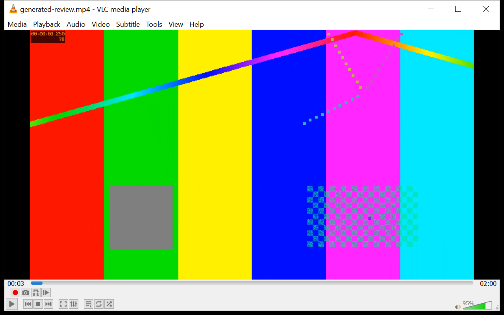
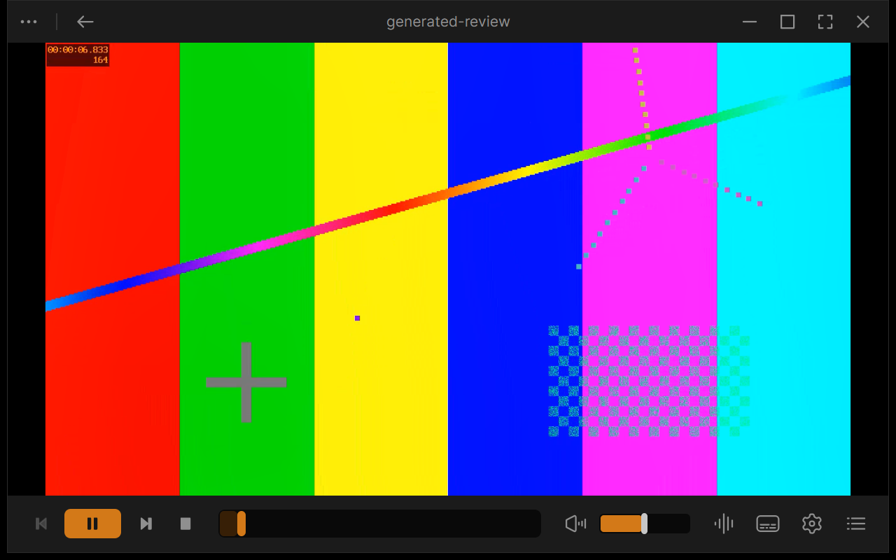
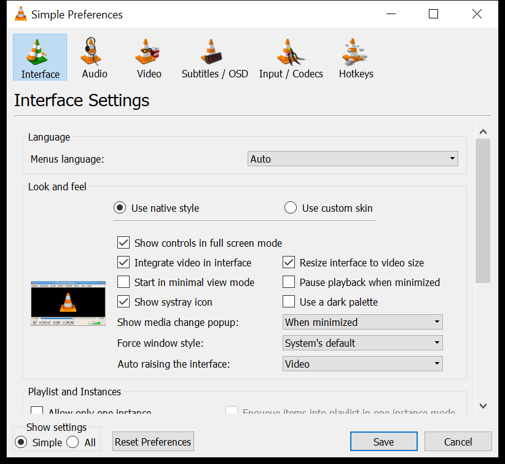
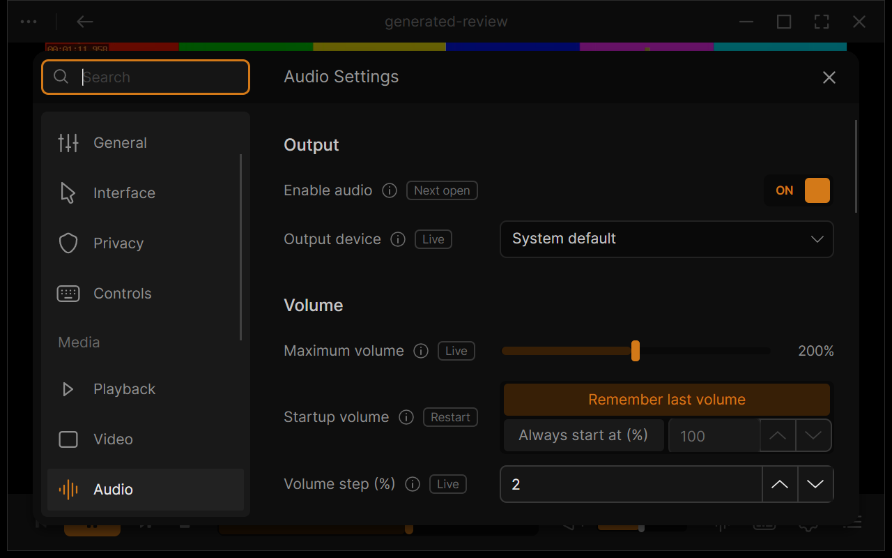
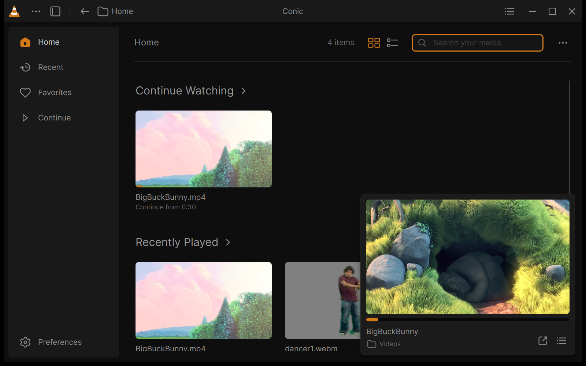
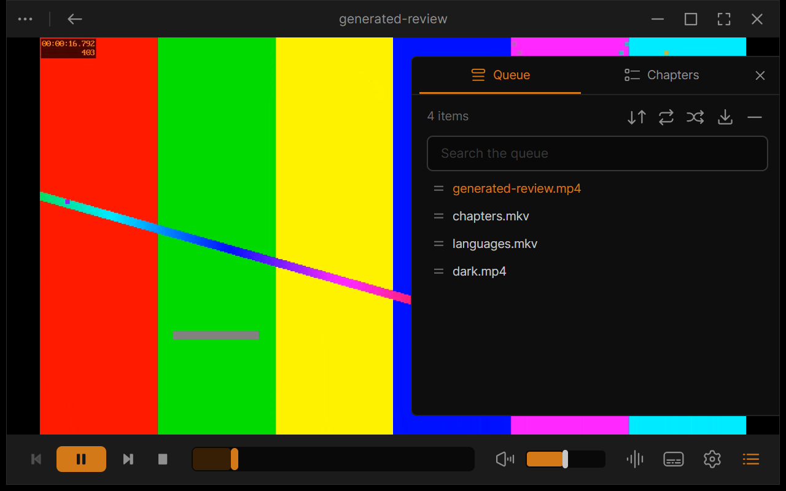
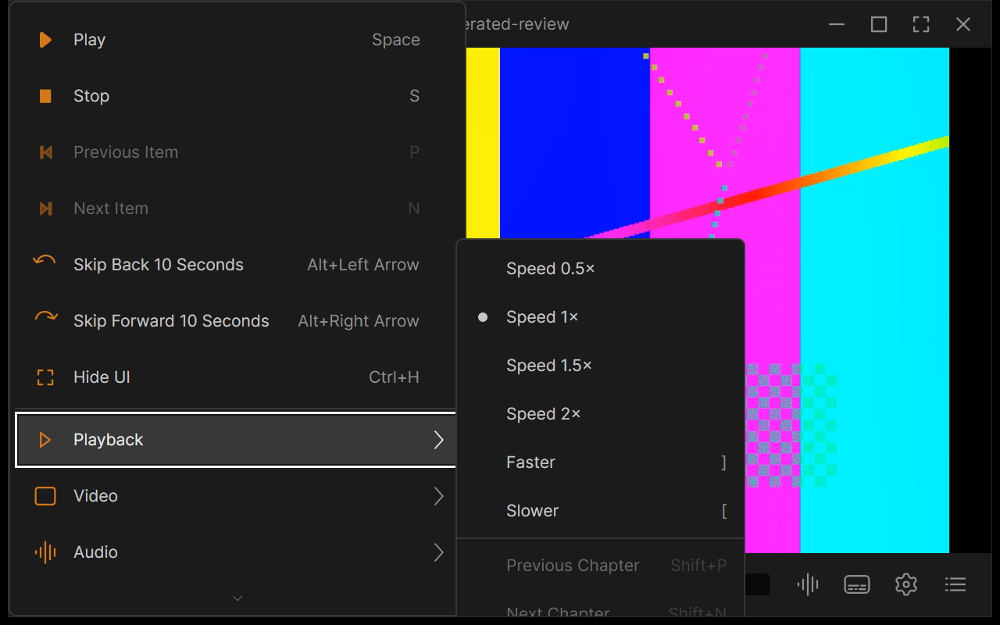
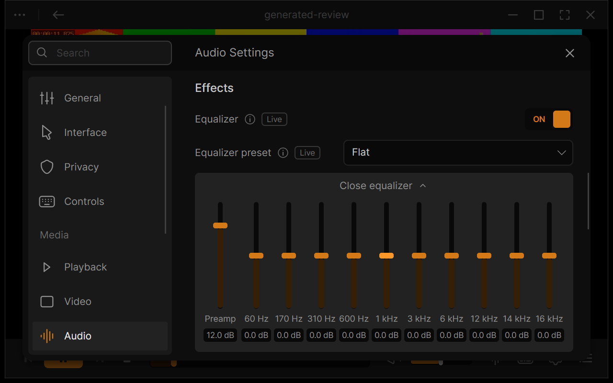
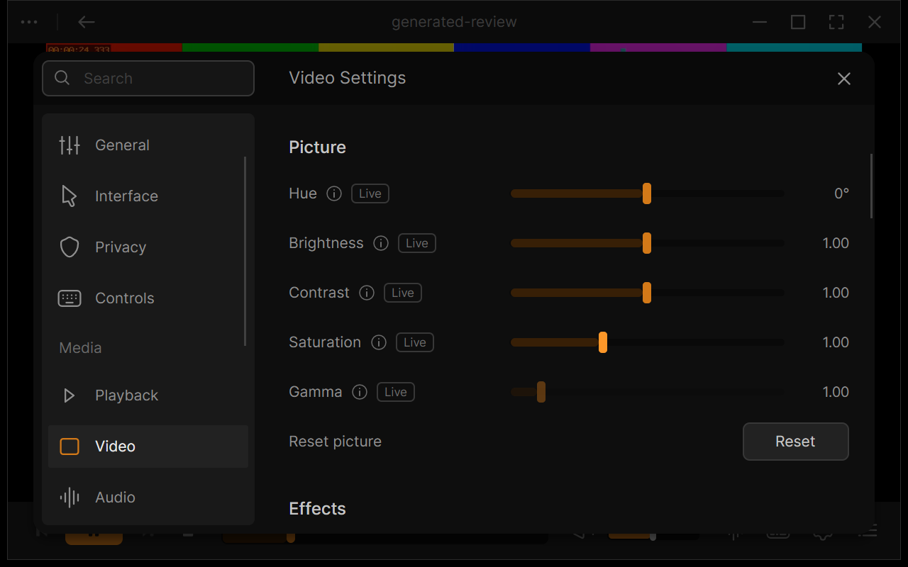
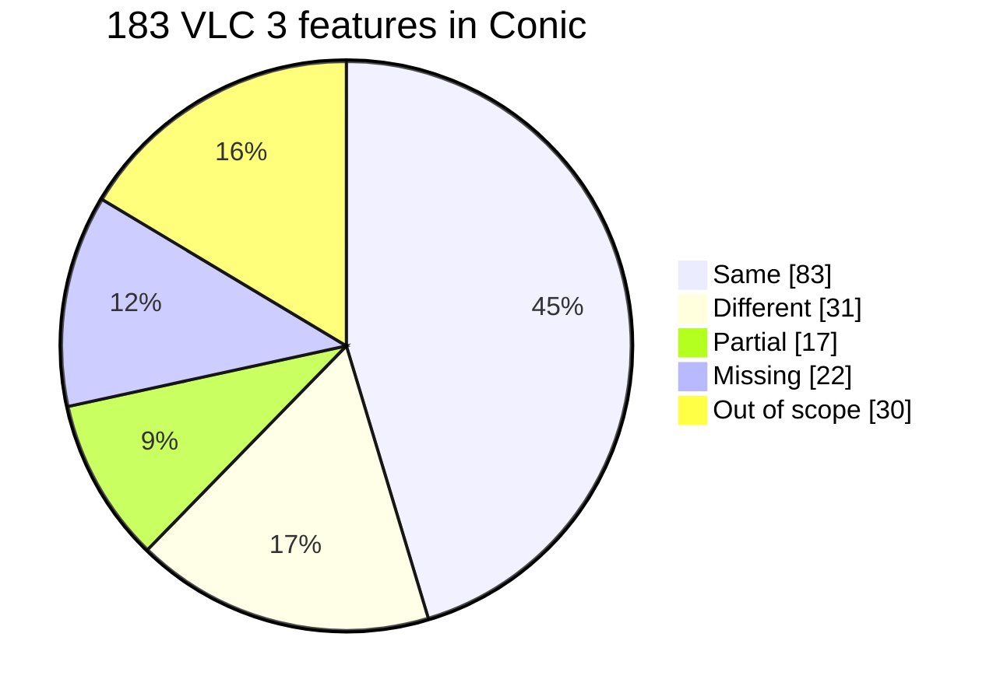

# Conic

Conic is a modern copy of VLC 3's desktop player. Media plays through VLC
3.0.24's own engine, and a new interface, written in C# with
[Avalonia](https://avaloniaui.net/), replaces VLC's Qt one. It runs on Windows,
macOS and Linux. It is an entry in the
[Avalonia Port Challenge](https://avaloniaui.net/blog/avalonia-port-challenge),
and this README is also its migration write-up.

> [!NOTE]
> Conic is an independent experiment. It is not made or endorsed by VideoLAN.

| VLC 3.0.24 | Conic |
| --- | --- |
|  |  |
|  |  |

More pairs: [VLC 3 and Conic, side by side](docs/contest/COMPARISON.md).

https://github.com/user-attachments/assets/e3d355eb-d84d-4d31-9c52-2dbd8bb15854

## Install

Download a portable build from
[Releases](https://github.com/mfkl/conic/releases). Each one bundles VLC
3.0.24, so no separate VLC install is needed. The builds are not signed, so
each OS warns on the first launch.

| Platform | Download | First launch |
| --- | --- | --- |
| Windows x64 | `Conic-<version>-win-x64.zip` | Unzip, run `Conic.exe`. If SmartScreen stops it: **More info**, **Run anyway**. |
| macOS | `Conic-<version>-osx-arm64.zip` (Apple silicon) or `-osx-x64.zip` (Intel) | Move `Conic.app` to Applications. When macOS refuses it: **System Settings > Privacy & Security**, **Open Anyway**, or run `xattr -dr com.apple.quarantine /Applications/Conic.app` once in Terminal. |
| Linux x64 | `Conic-<version>-linux-x64.tar.gz` | Extract, run `./Conic`. Needs glibc 2.38 or later: Ubuntu 24.04, Debian 13, Fedora 39 or newer. |

To remove Conic, delete its folder or app. Settings and history stay in your
user profile. To build it yourself, see [Building Conic](docs/BUILDING.md).

## Features

Conic keeps VLC 3 as it is (the same engine, codecs, filters and options) and
rebuilds the desktop app around it:

- **Home**, with recent media, favorites and saved positions, and a floating
  mini player while something plays.
- **The player**, with a docked control bar and side panels for the queue,
  audio, video, subtitles, chapters and media information.
- **Picture in picture**, an always-on-top compact player.
- **Settings**, in twelve pages. A tag on each row says when it takes effect:
  **Live**, at the **Next open**, or after a **Restart**.
- **Messages**, VLC's log, live.
- **Dark and Light themes**, accent colors and a compact density.

| | |
| --- | --- |
|  |  |
|  |  |

## Parity with VLC 3

Conic reaches **80% parity** with VLC 3's desktop player.
[Feature parity with VLC 3](docs/FEATURE_PARITY.md) compares 183 VLC 3
features: 83 work the same, 48 work differently or in part, 22 are missing and
30 were left out on purpose (disc menus, streaming and conversion, capture,
skins, extensions).

The everyday ways in are there: VLC's hotkeys, several files or URLs at once,
its network protocols, the command line, single-instance mode, the clipboard
and drops. So are its tools: snapshots, the A-B loop, frame stepping,
programs, subtitles added while playing, and its video effects, overlays and
crop, applied live. Conic adds 13 features VLC 3 doesn't have, such as picture
in picture and a Continue watching list.

## Porting VLC to Avalonia

### Starting point

VLC 3.0.24 is the baseline. Work started on 3.0.23 and moved to 3.0.24, first
a beta and from October 7 the official build; every comparison here is
against 3.0.24. VLC 3 is a C codebase whose desktop interface is a Qt 5 module
(`modules/gui/qt`) loaded by libvlccore like any other plugin. Qt 5 itself has
been out of support since 2023. The interface talks to the core through VLC's
internal objects and variables, not through the public LibVLC API.

### What it cost

- **Time.** 290 commits on 16 working days between August 31 and October 17,
  2026. Most of the app was built in two bursts: the player itself in early
  September, and VLC 3 parity, macOS and Linux in October.
- **Size.** About 28,000 lines of C# in `src` (of which about 5,900 drive the
  smoke tests), 6,800 lines of AXAML and 6,900 lines of unit tests.
- **Prior work.** [VLCLR](https://github.com/mfkl/vlclr), the C# framework for
  VLC plugins, existed before the challenge. Its `3.x` branch, for VLC 3, was
  written for Conic.
- **AI.** AI assistance (Claude Code) was used for implementation and
  testing.

### Approach

**Keep the engine, replace the interface.** The Qt widgets were not
translated. Each everyday workflow (open, queue, transport, tracks, subtitles,
video adjustments, media information, history and resume, preferences, the
log) was rebuilt as an Avalonia view over an engine contract
(`IMediaEngine`, immutable state snapshots, one serialized update stream).
The visual design follows Juxtopposed's
[VLC Redesign](https://www.figma.com/community/file/1691465999134370980/vlc-redesign).

**Talk to the core the way Qt does.** Conic loads libvlccore and starts each
core with `libvlc_InternalCreate`, `libvlc_InternalInit` and
`libvlc_InternalAddIntf`. Its control interface is a VLC plugin, so it reads
and sets variables on the playlist, the input and the audio output from
inside the core, as the Qt module does. This is what makes VLC's preferences
real in Conic: each Settings row maps to a VLC option or variable.

**Plugins in C#.** Both plugins, the control interface and the video output,
are written in C# with [VLCLR](https://github.com/mfkl/vlclr/tree/3.x) and
compiled with Native AOT into ordinary VLC 3 plugin libraries. There is no C
shim.

### What translated cleanly

- **The engine and its options.** Codecs, filters, network protocols and
  hardware decoding are VLC's own, untouched. A Settings row is a VLC option
  or variable, so most of VLC's preferences carried over as data rather than
  code.
- **VLC's tools.** Frame stepping, the A-B loop, snapshots, programs,
  deinterlacing, crop and the video effects are variables on the playing
  input or video output in VLC 3. Once the control plugin could set and
  trigger variables, each one was a few lines plus a smoke test.
- **Menus and hotkeys.** VLC's menu entries became one command registry:
  each command has a name, a menu and a default shortcut, and the macOS menu
  bar, the keyboard and the Controls settings page all read from it.
- **The design.** Avalonia's styles and resources took the Figma file's colors,
  type and spacing as tokens, which gave Dark and Light themes, accent colors
  and a compact density almost for free.

### What needed rethinking

- **Video.** See below: this was most of the work.
- **Dialogs into panels.** VLC's floating playlist, Effects and Filters
  dialog and two-level preferences became the redesign's side panels and
  twelve searchable Settings pages. Effects and Filters is now rows of
  Settings > Audio and Settings > Video.
- **When a setting applies.** VLC reads some options only when media opens or
  when the core starts. Rather than hide this, each Settings row carries a
  tag: **Live**, **Next open** or **Restart**. Rows VLC 3 can't honor in this
  app were dropped.
- **Platform conventions.** On macOS, Hide UI moved from Cmd+H, which macOS
  keeps for hiding the app, to Cmd+Shift+H, and Finder's Open With lists Conic
  through the bundle's document types.

### The hard part: video

VLC draws video into a native window it owns. Avalonia controls can't sit on
top of a foreign native window, and the design puts controls, panels and
menus over the video. Conic's video output plugin instead hands each decoded
frame to Avalonia's compositor as a GPU texture: a D3D11 keyed-mutex shared
texture on Windows, an IOSurface on macOS, a DMA-BUF on Linux. Video becomes
one more visual in the window, so z-order, transparency and animation just
work.

Linux came last. VLC's VA-API decoder decodes into surfaces the video output
provides; the output converts each one to BGRA with VA-API video processing
and exports it as a DMA-BUF, which Avalonia imports into its EGL compositor.
That import is new in Avalonia 12.2, so Conic builds against a 12.2 nightly
until it ships.

Getting a first frame on screen was quick. Making it hold up took most of the
time: hardware-decoded NV12 and P010 surfaces converted on the GPU, surface
ownership across threads, stale callbacks after stop, reopen cycles and plugin
discovery inside a portable package. Each got its own smoke test.

### What caught me by surprise

- **The macOS menu bar is bound once.** Avalonia's macOS backend ties a
  window to the first `NativeMenu` it exports and throws when given another.
  Rebuilding the bar on every settings change crashed Reset and quietly
  stopped live settings from applying, so Conic now updates the existing
  items in place.
- **Dark frames stop at Windows 11.** With the client area extended over the
  frame, Windows 10 paints the window's top pixel row in the frame color, and
  Avalonia only puts the frame in dark mode on Windows 11. Dark windows showed
  a white line on Windows 10 until Conic set the immersive dark mode attribute
  itself.
- **Shutting down from `Opened`.** Conic's smoke tests start from the main
  window's `Opened` handler. Shutting the app down there, before the main
  loop starts, throws a `NullReferenceException` inside
  `ClassicDesktopStyleApplicationLifetime`. I sent a fix to Avalonia:
  [pull request 22497](https://github.com/AvaloniaUI/Avalonia/pull/22497).

### Cross-platform

- **Windows x64:** D3D11 hardware decoding and GPU presentation, with a
  software upload path and a CPU bitmap fallback.
- **macOS arm64 and x64:** VideoToolbox decoding and IOSurface presentation,
  native fullscreen, the app menu, an `.app` bundle.
- **Linux x64:** VA-API decoding and DMA-BUF presentation, with a CPU
  fallback when VA-API or the import is unavailable. It runs on X11, and
  through XWayland in Wayland sessions.

One C# codebase covers all three. Platform code is limited to the video
backends, window chrome and a few OS services (audio devices, screensaver,
proxy password storage). Builds are portable archives that bundle VLC 3.0.24.

### Quality

- 670 unit tests for the engine contract, state, settings and view models.
- About 30 smoke modes drive the real app with real VLC and real media on
  Windows and macOS: every playback path, the default shortcuts, the queue,
  menus, Settings (the equalizer is measured on the audio output, network
  options against a local server), VLC 3's tools, network protocols from
  local servers, and picture in picture. On Linux they run in a private
  headless GNOME Shell; CI runs the Linux engine smokes from the packaged
  runtime.
- Packages are qualified outside the repository, from the zip.

### Lessons

- Reusing the engine was the right call; rebuilding the interface around
  workflows, not widgets, kept the port tractable.
- Composition-based video is the piece that makes an Avalonia player feel
  native, and also the piece that needs the most testing.
- A setting that does nothing is worse than no setting.

## Reporting a problem

Open **Messages** (**Ctrl+Shift+M**, **Cmd+Shift+M** on macOS), set
**Verbosity** to **Debug**, reproduce the problem, then **Save…** the log and
attach it to your report. Remember that Conic is not maintained.

## Credits

The interface, its icons and its Settings pages follow the
[VLC Redesign](https://www.figma.com/community/file/1691465999134370980/vlc-redesign)
Figma Community file by [Juxtopposed](https://www.youtube.com/@juxtopposed)
([I Redesigned VLC After 25 Years](https://www.youtube.com/watch?v=ERFeOgqk324)),
used with credit. Where the app differs from the design, the difference is
mine.

## License

GPL v2 or later; see [LICENSE](LICENSE). VLC is a trademark of VideoLAN.
