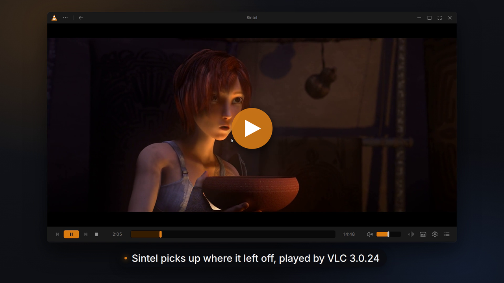
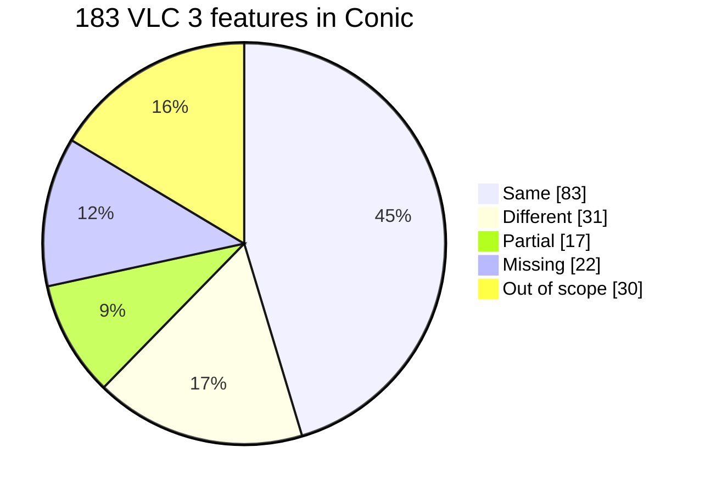

# Conic

Conic is a modern copy of VLC 3's desktop player. Media plays through VLC
3.0.24's own engine, and a new interface, written in C# with
[Avalonia](https://avaloniaui.net/), replaces VLC's Qt one. It runs on Windows,
macOS and Linux.

> [!NOTE]
> Conic is a one-off experiment. It is not made or endorsed by VideoLAN, it
> will not be maintained, and issues and pull requests may go unanswered. To
> watch videos, use [VLC](https://www.videolan.org/vlc/).

The demo plays Sintel, Big Buck Bunny, Tears of Steel and Caminandes, © Blender Foundation, CC BY.

## Install

Download a portable build from
[Releases](https://github.com/mfkl/conic/releases). Each one bundles VLC
3.0.24, so no separate VLC install is needed. The builds are not signed, so
each OS warns on the first launch.

| Platform | Download | First launch |
| --- | --- | --- |
| Windows x64 | `Conic-<version>-win-x64.zip` | Unzip, run `Conic.exe`. If SmartScreen stops it: **More info**, **Run anyway**. |
| macOS | `Conic-<version>-osx-arm64.zip` (Apple silicon) or `-osx-x64.zip` (Intel) | Move `Conic.app` to Applications. When macOS refuses it: **System Settings > Privacy & Security**, **Open Anyway**. |
| Linux x64 | `Conic-<version>-linux-x64.tar.gz` | Extract, run `./Conic`. Needs glibc 2.39 or later (Ubuntu 24.04). |

To remove Conic, delete its folder or app. Settings and history stay in your
user profile.

## Features

Conic keeps VLC 3 as it is (the same engine, codecs, filters and options) and
rebuilds the desktop app around it:

- **Home**, with recent media, favorites and saved positions, and a floating
  mini player while something plays.
- **The player**, with a docked control bar and side panels for the queue,
  audio, video, subtitles, chapters and media information.
- **Picture in picture**, an always-on-top compact player.
- **Settings**, in twelve pages. A tag on each row says when it takes effect:
  **Live**, at the **Next open**, or after a **Restart**.
- **Messages**, VLC's log, live.
- **Dark and Light themes**, accent colors and a compact density.

| | |
| --- | --- |
|  |  |
|  |  |

## Parity with VLC 3

Conic reaches **80% parity** with VLC 3's desktop player, over 153 features
(30 more were left out on purpose). See
[Feature parity with VLC 3](docs/FEATURE_PARITY.md) for the comparison by
feature, and [VLC 3 and Conic, side by side](docs/contest/COMPARISON.md) for
the same workflows in both apps.

## How it's built

- **Avalonia 12** draws the whole interface, from one C# codebase.
- **VLC 3.0.24, through libvlccore.** Instead of the public LibVLC API, Conic
  starts VLC's core the way VLC's own interfaces do, so it can pass each core
  its options, change variables on the playing input and load its own plugins.
- **[VLCLR](https://github.com/mfkl/vlclr/tree/3.x)**, a C# framework for VLC 3
  plugins compiled with Native AOT. Conic's control interface and video output
  are VLCLR plugins, with no native C shim.
- **Video inside Avalonia's composition.** Decoded frames reach Avalonia as GPU
  textures (D3D11 on Windows, IOSurface on macOS, DMA-BUF on Linux), with
  hardware decoding and no copy through the CPU.

Conic was built with AI assistance (Claude Code). To build it yourself, see
[Building Conic](docs/BUILDING.md).

## Reporting a problem

Open **Messages** (**Ctrl+Shift+M**, **Cmd+Shift+M** on macOS), set
**Verbosity** to **Debug**, reproduce the problem, then **Save…** the log and
attach it to your report. Remember that Conic is not maintained.

## Credits

The interface, its icons and its Settings pages follow the
[VLC Redesign](https://www.figma.com/community/file/1691465999134370980/vlc-redesign)
Figma Community file by [Juxtopposed](https://www.youtube.com/@juxtopposed)
([I Redesigned VLC After 25 Years](https://www.youtube.com/watch?v=ERFeOgqk324)),
used with credit. Where the app differs from the design, the difference is ours.

## License

GPL v2 or later; see [LICENSE](LICENSE). VLC is a trademark of VideoLAN.
