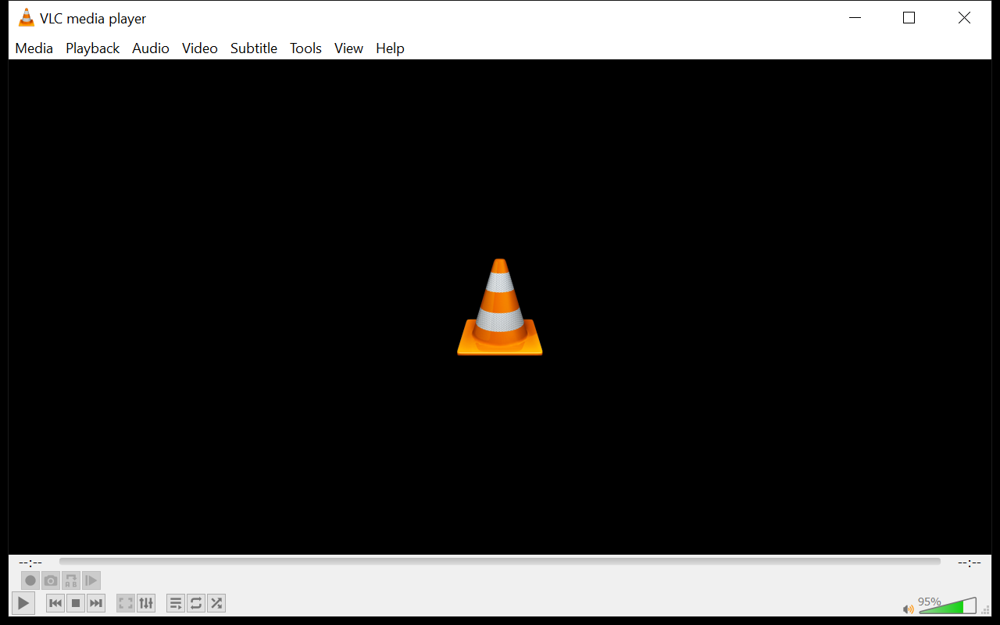
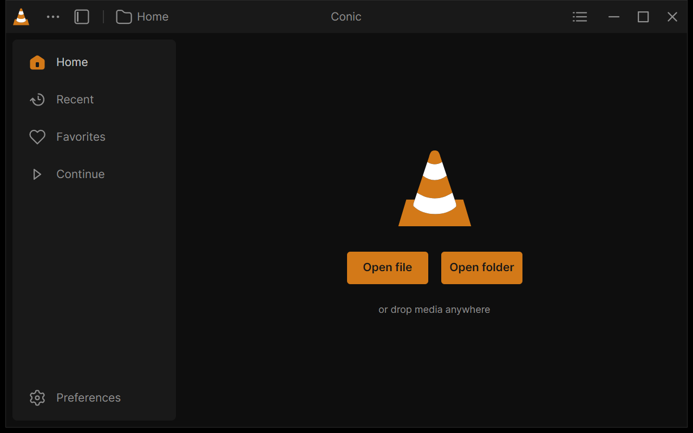
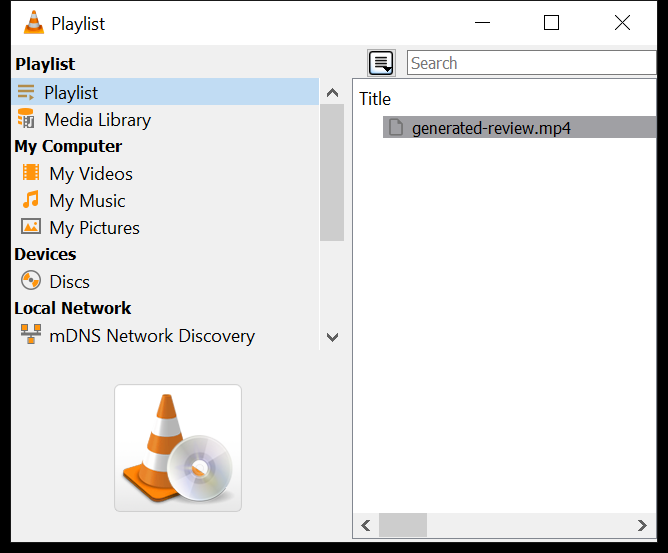
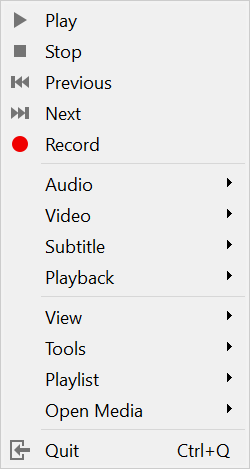
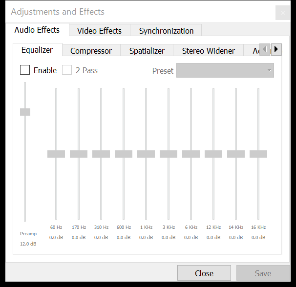
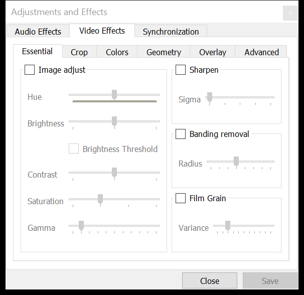

# VLC 3 and Conic, side by side

Native window captures taken October 14, 2026 on one Windows display (Intel
Iris Xe). Before: the installed VLC 3.0.24 with its default Qt
interface. After: Conic built from `feature/vlc3-parity`, on the same VLC
3.0.24 engine. Main windows are 1280×800; VLC's dialogs and menus are shown
at their own size.

| Workflow | VLC 3.0.24 | Conic |
|---|---|---|
| Start screen |  |  |
| Playback with controls |  |  |
| Playlist / queue |  |  |
| Right-click menu |  |  |
| Preferences |  |  |
| Equalizer |  |  |
| Picture adjustments |  |  |

Both players show the same generated H.264 test pattern at different
timestamps, so the frames illustrate layout, not color or performance. The
Conic captures contain real GPU video: the frame is composed by Avalonia, under
the controls, in the same window. VLC's floating playlist window is a setting of
this machine's VLC; VLC can also dock it in the main window.

Equivalents, not one-to-one copies: VLC's Effects and Filters dialog becomes
rows of Settings > Audio and Settings > Video in Conic, and Conic's context
menu is the redesign's, with VLC 3's entries.

## How the captures were taken

`eng/capture-window.ps1 -ProcessId <id> -OutputFile <png>` sizes a process's
main window and captures its native pixels (PrintWindow, DPI aware). VLC's
dialogs and Conic's panels were opened with clicks posted to each app's own
window, so nothing took the foreground. Conic's context menu comes from
`--menu-review=context-playback`. Inspect each PNG before using it as video
evidence: a successful capture call alone doesn't prove the video frame was
captured.
