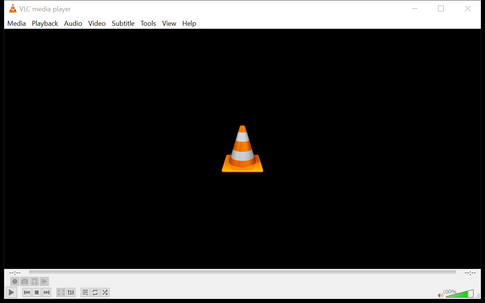
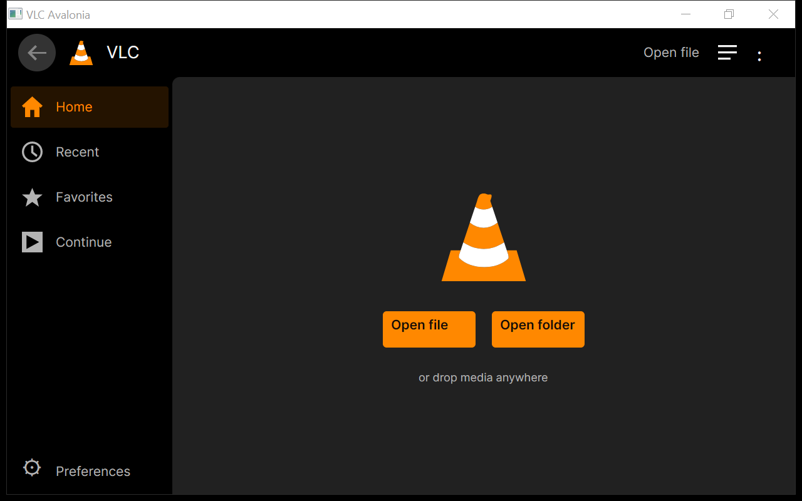
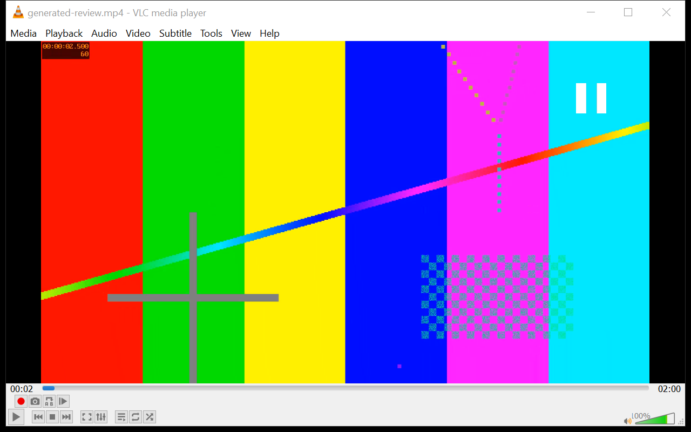
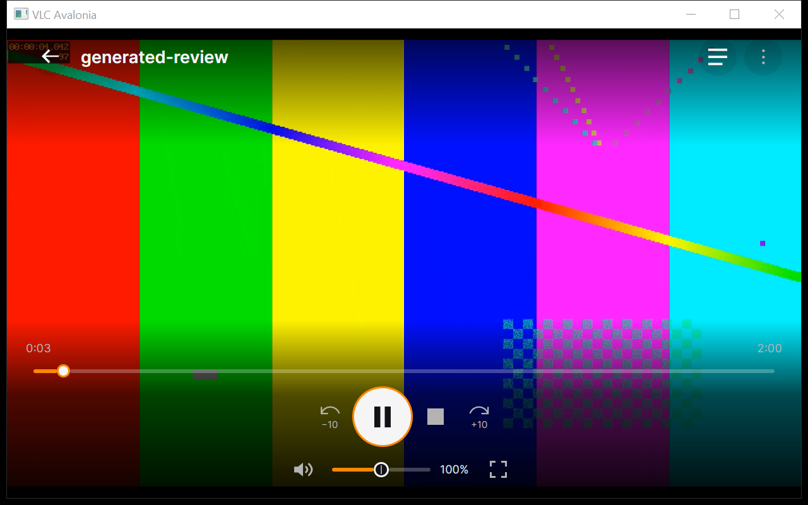

# VLC desktop → Avalonia

Native window captures, September 12, 2026, at 1280×800 physical pixels on the
same Windows display. Before: installed VLC 3.0.23. After: the extracted
Windows package identified in [qualification](QUALIFICATION.md).

| Workflow | VLC 3.0.23 | Conic |
|---|---|---|
| Empty Home / player |  |  |
| Playback with controls |  |  |

Playback uses the same generated H.264 test pattern at different timestamps;
this illustrates layout, not a frame-accurate color/performance comparison.
The Avalonia image contains actual GPU video. Native window captions and the
responsive control layout are part of the captured application.

The existing root `home.PNG` and `playback on hover.PNG` are UI references,
not these captures. The comparison does not claim VLC feature or subtitle
parity. Further queue/settings/PiP comparisons and a final-release demo remain
to be prepared.

Capture a running review process with
`eng/capture-window.ps1 -ProcessId <id> -OutputFile <png>`. The tool selects
only that process's window, sizes it for comparison, and captures its native
pixels with DPI awareness; inspect the PNG before accepting video evidence.
`-Pause` sends Space to that window, so use it only when playback is active and
the player owns that shortcut.
